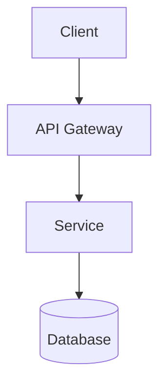

# YourName.dev — Astro Portfolio & Engineering Blog

A dark, responsive, Markdown-first technology portfolio built with Astro and designed for GitHub Pages.

## Requirements

- Node.js 22 or newer
- npm
- A GitHub repository

## Run locally

```bash
npm install
npm run dev
```

Open the local URL printed by Astro.

## Customize before publishing

1. Search the project for `YourName`, `YOUR_GITHUB_USERNAME`, `your.email@example.com`, and `https://github.com/YOUR_GITHUB_USERNAME`.
2. Edit `src/data/site.ts` for your name, role, summary, links, and expertise.
3. Edit `astro.config.mjs`:
   - `site` should be your final canonical site URL.
   - For a repository site such as `https://username.github.io/repo/`, set `base: '/repo'`.
   - For a user site repository named `username.github.io`, keep `base: '/'`.
4. In GitHub, go to **Settings → Pages** and select **GitHub Actions** as the build and deployment source.
5. Push to the `main` branch. The workflow in `.github/workflows/deploy.yml` builds and deploys the static site.

## Add a blog post

Create a `.md` file under `src/content/blog/`. Example:

```md
---
title: "A useful engineering lesson"
description: "What I learned, why it matters, and how to apply it."
pubDate: 2026-10-20
tags: ["Architecture", "Engineering"]
category: "Architecture"
draft: false
---

## Context

Explain the problem and constraints.

## Architecture



## Implementation

```java
public class Example {
    public String greet() {
        return "Hello, architecture!";
    }
}
```
```

Posts with `draft: true` are excluded from the public blog.

## Multi-language code tabs

Use the `CodeTabs` component in an `.mdx` post:

```mdx
import CodeTabs from '../../components/CodeTabs.astro';

<CodeTabs examples={[
  { label: 'Java', language: 'java', code: 'System.out.println("Hello");' },
  { label: 'TypeScript', language: 'ts', code: 'console.log("Hello");' },
  { label: 'Python', language: 'python', code: 'print("Hello")' }
]} />
```

Use a single-quoted JavaScript string for `code`, or template literals for multi-line snippets. Escape backticks inside template literals.

## Diagrams

Fenced Mermaid blocks are supported in Markdown/MDX. They are rendered by the article layout in the browser using Mermaid. For Mermaid's current syntax, see https://mermaid.js.org/.

## Content layout

- `src/content/blog/` — Markdown and MDX posts
- `src/data/site.ts` — personal details and skills
- `src/pages/` — pages and routes
- `src/components/` — reusable UI components
- `public/` — static assets

## Notes

- The starter intentionally contains sample content. Replace it with your own examples before publishing.
- Contact details and social links are placeholders.
- This is a static site; it does not require a database or backend.


## Profile photo

Place your portrait image at `public/images/profile.jpg` (a square crop works best). The home page includes a fallback monogram until that file is added. Update the “Your Name” text in `src/pages/index.astro` to your preferred display name.

## Developer tools

The `/tools/` page includes JSON formatting/minification, Base64 encoding/decoding, structural JSON comparison, XML formatting/minification, and XML comparison. These utilities run in the browser; inputs are not sent to a server. XML comparison is whitespace-normalized rather than a semantic XML diff.

### Developer tools navigation

The Tools area now uses a persistent left sidebar and displays one utility at a time. Each utility has a static, bookmarkable URL under `/tools/`, for example `/tools/json-formatter/`, `/tools/json-compare/`, and `/tools/jwt-inspector/`. The selected utility is rendered directly on refresh, and the main header's Tools item links to the tools workspace without a dropdown.
