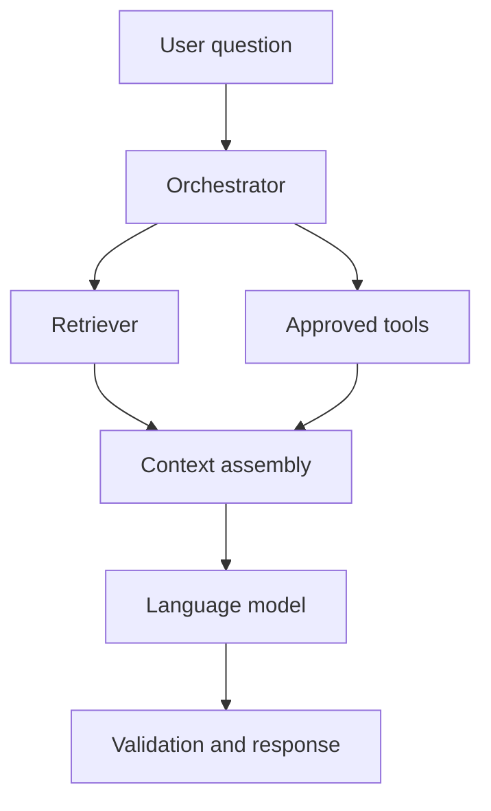

Retrieval-augmented generation (RAG) combines a language model with relevant external information. An agentic workflow can add controlled decisions about which retrieval or application tools to use.

## Architecture overview

The diagram is conceptual. A production workflow may require authorization filters, retries, timeouts, tracing, evaluation, and human approval for sensitive actions.

## A small retrieval-first example

import CodeTabs from '../../components/CodeTabs.astro';

<CodeTabs examples={[
  { label: 'Python', language: 'python', code: 'def answer(query, retriever, llm):\n    documents = retriever.search(query)\n    context = format_context(documents)\n    return llm.generate(query=query, context=context)' },
  { label: 'TypeScript', language: 'ts', code: 'async function answer(query, retriever, llm) {\n  const documents = await retriever.search(query);\n  const context = formatContext(documents);\n  return llm.generate({ query, context });\n}' },
  { label: 'Java', language: 'java', code: 'Answer answer(String query) {\n    var documents = retriever.search(query);\n    var context = formatContext(documents);\n    return llm.generate(query, context);\n}' }
]} />

These snippets illustrate the same general flow. The interfaces are placeholders, so adapt them to the framework and APIs in your application.

## Engineering considerations

### Retrieval quality

Measure whether relevant documents are retrieved, not just whether the generated answer sounds plausible.

### Permissions and data boundaries

Apply access control during retrieval. Do not rely on the model to decide whether a user may see a document.

### Observability and evaluation

Capture retrieval outcomes, latency, token usage, tool calls, and quality metrics. Build representative evaluation sets before changing prompts or models.

## Key takeaway

An agentic RAG system should make tool use observable and constrained. Add autonomy only where it provides a measurable benefit over a simpler retrieval pipeline.
