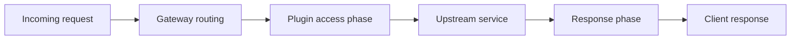

A gateway plugin sits on a critical request path. Keep its responsibilities narrow, configuration explicit, and failure behavior predictable.

## Plugin request flow



The exact lifecycle and available handlers depend on the Kong version and plugin type. Validate implementation details against the version you deploy.

## Example configuration shape

```yaml
# Illustrative configuration only; define a matching schema
# and validate this shape for your Kong version.
config:
  enabled: true
  timeout_ms: 1500
  mode: "strict"
```

## Testing checklist

- Validate required fields, types, defaults, and invalid values.
- Test successful requests and expected rejection behavior.
- Define timeout and upstream failure behavior.
- Ensure logs avoid credentials and sensitive payloads.
- Test compatibility with the intended Kong version.
- Document deployment, rollback, and configuration changes.

## Key takeaway

Treat a plugin as production middleware: make behavior explicit, minimize hidden side effects, and test both normal and failure paths.
