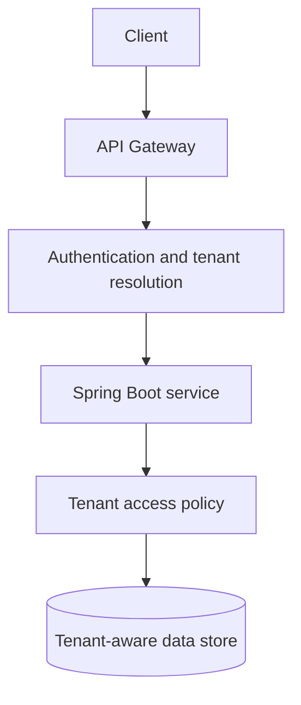

Multi-tenancy lets one application serve multiple customers while enforcing clear boundaries between their data and operations. The right design depends on isolation requirements, regulatory constraints, cost, and operational complexity.

## Start with the isolation model

Common approaches include a shared schema with a tenant key, separate schemas, or a separate database per tenant. Each has different operational and security trade-offs.

| Model | Benefits | Trade-offs |
| --- | --- | --- |
| Shared schema | Lower operational overhead | Strong tenant filtering is essential |
| Schema per tenant | More logical separation | Migrations and connection management become harder |
| Database per tenant | Stronger isolation options | Higher provisioning and maintenance costs |

## High-level architecture



Tenant identity must be derived from a trusted authentication and authorization context. A client-provided header by itself is not proof that the caller may access that tenant.

## Represent tenant context explicitly

```java
public record TenantContext(String tenantId) {
    public TenantContext {
        if (tenantId == null || tenantId.isBlank()) {
            throw new IllegalArgumentException("tenantId is required");
        }
    }
}
```

This small value object makes tenant context visible in method signatures and tests. In a real application, tenant resolution and authorization should be handled in a well-defined request boundary.

## Implementation checklist

- Authenticate the caller before resolving tenant access.
- Validate that the caller is authorized for the selected tenant.
- Apply tenant filtering consistently to reads, writes, caches, and background jobs.
- Include tenant context in logs and traces without exposing sensitive data.
- Test cross-tenant access attempts explicitly.
- Plan schema changes, migrations, backups, and tenant offboarding.

## Key takeaway

Tenant isolation is a system-wide property, not just a database query condition. Design and test it across every path where tenant-scoped data can flow.
