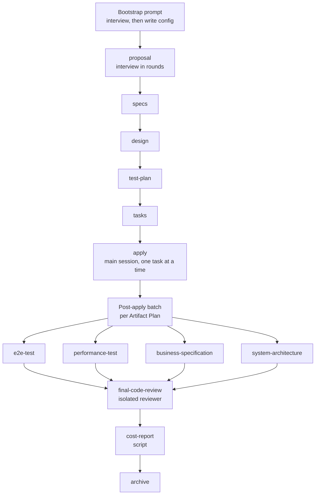

AI coding agents are fast, and that is the problem. An agent will happily start writing code before anyone has agreed on what the change is for. It skips the edge cases nobody mentioned, writes tests that assert nothing useful, and leaves the architecture notes a month out of date. By the time a human notices, the diff is large and the reasoning is gone.

`openspec-sdlc-starter` is my attempt to put a delivery process around that speed. It installs an OpenSpec schema called `sdlc-workflow`, a set of Claude Code subagent bindings, and two bootstrap prompts into a repository. The result is a fixed path for every change: an interview, a proposal, specs, a design, a test plan, a task list, implementation, end-to-end and performance tests, ledger updates, an adversarial review, and a cost report. Each step writes a file, and each file is a gate.

This article explains how the whole thing works, from install to archive, and why it is built the way it is. The source is at [github.com/sambasiva-dev/openspec-sdlc-starter](https://github.com/sambasiva-dev/openspec-sdlc-starter).

## The short version

- The package copies files into your repo. It does not run a service or a daemon.
- A **bootstrap prompt** interviews you once and writes the project-specific files: `openspec/config.yaml`, `openspec/standards.md`, and the living ledgers.
- Every change then moves through **eleven artifacts** and an **apply** phase. Each artifact is written by a dedicated **persona subagent** with its own role prompt.
- Some artifacts are **write-through**: they write a per-change file and also merge into a repo-level ledger.
- A **final review** runs in an isolated context before archive. It grades findings and gives a verdict.
- A **script**, not a model, writes the cost report from the session logs.

## What gets installed

Running the installer with `--agent claude --bootstrap greenfield` writes these files into your repository:

| Path | Purpose |
| :-- | :-- |
| `openspec/schemas/sdlc-workflow/` | The schema, its templates, the cost tool and a pricing table |
| `openspec/roles/` | Tool-independent role definitions for each persona |
| `openspec/ORCHESTRATION.md` | Rules for the main session: dispatch, review depth, the post-apply batch |
| `.claude/agents/` | Claude Code bindings that point each persona at its role file and pin its model |
| `.claude/commands/opsx/` and `.claude/skills/openspec-*` | The slash commands and skills that drive the workflow |
| `openspec/export-reference/config.reference.yaml` | A template with `<FILL: ...>` placeholders for the bootstrap to complete |
| `openspec/bootstrap/` | The bootstrap prompt you paste into Claude Code |
| `docs/specification.md`, `docs/design.md`, `docs/history/` | Empty living ledgers, created only if missing |

The split between these files is deliberate. The schema and roles are **portable**: they contain no language, framework or domain specifics, so the same directory can be dropped into any repo. Everything project-specific goes into `openspec/config.yaml` and `openspec/standards.md`.

## How the pieces fit together

Planning artifacts run in order, and each one requires the one before it. Apply runs in the main session because implementation needs to run tests, read failures and iterate across files. The post-apply batch runs next, and then the final review, which is the last gate before archive.

## The eleven artifacts

| # | Artifact | Requires | Writes | Persona |
| :-- | :-- | :-- | :-- | :-- |
| 1 | `proposal` | none | `proposal.md`, `interview.md` | product-engineer |
| 2 | `specs` | proposal | `specs/**/*.md` | product-engineer |
| 3 | `design` | specs | `design.md` | principal-architect |
| 4 | `test-plan` | design | `test-plan.md` | sdet-agent |
| 5 | `tasks` | test-plan | `tasks.md` | tech-lead |
| — | **apply** | tasks | tracks `tasks.md` | main session |
| 6 | `e2e-test` | proposal, tasks | `e2e-test.md` plus the e2e suite | automation-qa |
| 7 | `performance-test` | proposal, tasks | `performance-test.md` plus load scripts | performance-engineer |
| 8 | `business-specification` | proposal, tasks | `business-specification.md` plus the product ledger | product-engineer |
| 9 | `system-architecture` | proposal, tasks | `system-architecture.md` plus the architecture ledger | principal-architect |
| 10 | `final-code-review` | all four above | `final-code-review.md` | senior-staff-reviewer |
| 11 | `cost-report` | final-code-review | `cost-report.md` | script: `phase-cost.py` |

Artifacts 6 to 9 are **selectable**. The proposal declares which of them a change needs, so a small change does not have to produce a performance suite it cannot use. Artifact 10 always runs. Artifact 11 is generated by a script and is never written by a model.

The four write-through artifacts (6, 7, 8 and 9) deserve a note. OpenSpec only allows `generates:` to point inside the change directory, so each of them writes a per-change record there and also merges into a repo-level file. For example, `business-specification` writes its per-change record into the change folder and then merges the functional change into `docs/specification.md`.

## Step zero: the bootstrap interview

Install is one command. The real setup happens in Claude Code, where you paste the bootstrap prompt. The package ships two:

- `greenfield.md` for a new repository with no code yet.
- `brownfield.md` for an existing codebase.

The greenfield prompt runs in five steps. Step 0 checks that the portable files exist and that `openspec/specs/` is empty, because a repo with existing specs is not greenfield. Step 1 reads whatever already exists, such as a README, a product brief or an ADR, and notes any `CLAUDE.md` for merging. Step 2 asks one round of questions. Step 3 writes the files, but only after you confirm a playback. Step 4 verifies the result.

The brownfield prompt adds discovery. It learns the codebase before asking anything, runs the existing test suite to record a baseline, writes baseline specs that describe the as-is behaviour, and fills `docs/history/baseline.md`. The point is to stop the workflow from treating today's accidental behaviour as a spec that nobody agreed to.

Step 3 writes the project-owned files:

- **`openspec/config.yaml`**. This holds a `context:` block with the domain, stack, testing tools, paths and conventions. It also holds per-artifact `rules:` that route each artifact to its persona and list the project's risk triggers. Context is returned on every artifact call, so the prompt keeps it dense. Rules are returned only to the artifacts that need them.
- **`openspec/standards.md`**. The implementation standards: language, logging, naming, error handling and domain-safety rules. The apply phase reads this before its first edit, and a MUST violation here is an automatic critical finding at review.
- **`AGENT.md` and `CLAUDE.md`**. Entry points that tell any agent how to find the workflow.
- **Living ledgers**. Index files plus per-component files. These are the long-lived record of what the product does and how it is built.

Step 3 also writes a decisions record, so the choices made in the interview survive the session. Subagents cannot see the conversation, so anything that is not on disk is lost.

## The proposal: an interview before a draft

The proposal is where most workflows fail, so this one is strict. The schema's proposal instruction says plainly: **interview first, do not draft on guesses**. The instruction describes the cost of a wrong proposal in exactly these terms: every later artifact inherits it.

The interview runs in rounds. The subagent researches the repository first, so it never asks a question the code can answer. It then asks every remaining gap in a single numbered list, at most eight questions, most important first. Each question says why the answer matters and offers concrete options with a recommendation where the space is small. After that, it writes a playback of at most ten lines and asks for confirmation. The target is two rounds plus the playback.

The checklist the interview must establish covers the problem, actors and triggers, scope including what is explicitly out, business rules and money handling, failure and edge cases (idempotency, partial failure, downstream outages), integration points, non-functional needs, acceptance criteria and risk triggers.

The proposal subagent runs in an isolated context and cannot ask the user anything directly. So the main session relays. It gives you the whole list verbatim, sends your answers back verbatim to the same subagent, and repeats until you confirm the playback. Every answer is recorded in `interview.md` with a numbered question and an answer. The main session never edits that file. That is the only trustworthy record of what you said.

The proposal then has a few sections worth knowing:

- **What Changes** and **Capabilities**. Capabilities are the contract with the specs phase. A **New** capability becomes a new spec file. A **Modified** capability points at an existing spec whose requirements change. The instruction insists on reusing existing capability paths instead of creating near-duplicates, and it forbids inventing a requirement just to satisfy validation.
- **Artifact Plan**. A table that declares, for each selectable artifact, `Include` or `Exclude` with a one-line reason. An excluded artifact writes no file at all, so that line is the entire record of the decision. The rule is that absence of the table means everything is included. Absence is never exclusion.
- **Review Depth**. One of `focused`, `standard` or `escalated`. It sets how deep the final review goes and which reviewer model runs it.

## Specs, design, test plan, tasks

**Specs** define behaviour and nothing else. The test is simple: if the implementation can change without changing externally visible behaviour, it does not belong in a spec. Each requirement uses `SHALL` or `MUST`, and each has at least one scenario. Scenarios use exactly four hashtags and a WHEN/THEN list. The schema is blunt about the failure mode: "Three, or a bullet, fails SILENTLY." A spec delta can contain ADDED, MODIFIED, REMOVED and RENAMED requirement blocks. A MODIFIED block must carry the full updated requirement, because partial content loses detail at archive time.

The scenarios are also a contract with tests. The spec instruction says each scenario maps one-to-one to a named test in the test plan, and that a scenario must assert a concrete value, state or error. The phrase "works correctly" is banned because nothing can check it.

**Design** is written when the change is cross-cutting, introduces a new pattern or dependency, changes the data model significantly, or carries security, performance or migration risk. It explains the decisions, meaning why X over Y, along with structure, contracts, risks and a migration plan. It also has an open-questions section, with a strict rule attached: if an answer would change the specs, the approach or the task breakdown, you ask the user now. Deferring it is not allowed.

**Test plan** maps every scenario to a test case, stating the component under test, the arrange-act-assert shape, what is mocked and what is real, and the setup needed for isolation. The test plan makes no red-first requirement. Tests are written alongside the code.

**Tasks** are where the workflow becomes mechanical. The checkbox format is parsed by the apply phase. A box containing only an `x`, in any case or spacing, counts as done. Every other marker, including `[~]`, `[-]` and `[]`, reads as unfinished. A line without a checkbox is not tracked at all. Each task is `- [ ] X.Y <description>`, groups use numbered `##` headings, and each task names how its completion is verified.

## Who writes what: personas and bindings

The package splits each persona into two files, and the split matters.

The **role** file, in `openspec/roles/<role>.md`, holds the definition: the quality bars, the honesty rules and the working contract. It is tool-independent. The **binding**, in `.claude/agents/<role>.md`, holds only the Claude Code specifics: the tool grant, the model, and a line that says "read the role file first." The binding's own description is explicitly marked as a catalogue entry, not instructions. That guards against a subagent acting on a one-line summary and silently skipping the rules.

The routing is:

| Artifact | Subagent | Model |
| :-- | :-- | :-- |
| proposal, specs, business-specification | product-engineer | inherits the session model |
| design, system-architecture | principal-architect | inherits |
| test-plan | sdet-agent | inherits |
| tasks | tech-lead | inherits |
| e2e-test | automation-qa | inherits |
| performance-test | performance-engineer | inherits |
| final-code-review, Review Depth `focused` or `standard` | senior-staff-reviewer | Sonnet 5.5 |
| final-code-review, Review Depth `escalated` | senior-staff-reviewer-escalated | Opus 5.5, medium effort |

Six authoring roles inherit the session's model. The reviewer is pinned on purpose: the strength of the final review should not depend on whichever model the session happened to start with. The escalated reviewer is a separate binding over the same role file, so both reviewers apply identical standards and differ only in model.

The main session follows a standing rule for every artifact:

1. Run `openspec instructions <artifact-id> --change <name> --json` in the main session. This returns the template, the instruction, the context, the rules and the dependency paths.
2. Dispatch the mapped subagent and pass it all of that. The `context` is explicitly not optional, because the schema is project-agnostic and the stack reaches the subagent only through it.
3. Check that the artifact exists at the expected path, plus any write-through file.

There is also a **hard stop** rule. If the mapped subagent type is not available, the main session stops and tells you. It must not write the artifact itself as a fallback. The orchestration document explains why this is the dominant failure mode: bindings register at session start, so a new or renamed agent does not exist until you restart Claude Code. A silent self-author looks exactly like a successful delegation, so the rule turns it into an error instead.

Isolation is the core idea. The reviewer, in particular, has to be unable to rationalise the implementation it did not watch being written. That only works if its context contains the diff, the artifacts and the standards, and nothing about how the decisions were argued in the conversation.

## Apply: one task at a time, honestly

`/opsx:apply` runs in the main session. Before its first edit, it reads `openspec/standards.md`. The process rules are short and non-negotiable:

- Write each task's code and the tests the test plan names for it, together.
- Run the full suite after each task. Never mark a task complete on a red or skipped suite.
- Tick the checkbox only when the task is done and verified by the means the task names.
- Report honestly. If a task is blocked or only partly verified, say so. Never tick a box to keep momentum.
- Change no more than the tasks require. An unrelated refactor found mid-task is a finding to report, not work to fold in.

The last rule matters more than it looks. Agents are very good at tidying code they touch, and a change that quietly expands in scope is hard to review.

## The post-apply batch

When apply reports every task done and did not pause, the main session does not stop at "ready to archive." It runs the **post-apply batch** in the same turn. This is the step most likely to be skipped without an explicit rule, so the package encodes it in three places: the orchestration document, the schema's apply instruction, and the config's `operations.apply.guidance`. The config copy exists because the CLI replaces the apply instruction with a fixed string the moment the last box is ticked.

The batch works like this:

1. Read the `## Artifact Plan` table in the proposal.
2. Map each row to an artifact ID from `openspec status`. If a row names an ID that is not in the list, or the table is malformed, stop and ask. The rule is explicit: never fuzzy-match, because that is how a performance test silently disappears.
3. Author the included artifacts in a fixed order: `e2e-test`, then `performance-test`, then `business-specification`, then `system-architecture`, then `final-code-review`, then `cost-report`.
4. Do not spawn an excluded artifact just to let it decline. That costs a full instruction payload for nothing.

The batch does not run if apply paused, if any task is still unticked, or if you interrupted. A half-built change should not produce end-to-end suites and ledger merges for code that does not exist.

### The end-to-end and performance layers

These two artifacts write both a plan and runnable code. Their instructions are strict about what counts as a test.

The **e2e** suite runs against a deployed instance over a real socket, because that is the only layer that catches a port that is not exposed or a route that is not registered. It reads the target from the environment and never hardcodes a host. Every test maps to a Given/When/Then journey, and each test body opens with matching comments. A test without a story, or a story without a test, is a review-blocking gap.

The **performance** scripts encode every service level indicator as a threshold, so a breach fails the run instead of printing a number for someone to interpret. The instruction includes threshold calibration advice that I think is the most useful part of the whole package. It says to target what the code should achieve rather than a platform-wide SLO, because a 200 ms P95 on an endpoint with no dependencies "passes at roughly twenty times its real cost and detects nothing." It says that for an endpoint touching no datastore or external system, the error-rate threshold is 0.00%, because an allowance would hide a host defect. It also says results stay `_pending_` until a run actually happens, so a target is never presented as an observed result.

### The living ledgers

The business and architecture artifacts keep two repo-level records current. They are split by component, and the index is kept small on purpose:

- `docs/specification.md` is an index. Component files under `docs/spec/` hold journeys, business rules and a feature status matrix. The product ledger is entirely non-technical. It never names a datastore, endpoint or queue, because it describes what the business can now do.
- `docs/design.md` is an index. Files under `docs/design/` hold the component diagrams, the data model, platform decisions and telemetry. Planned components are drawn dashed and labelled PLANNED. The instruction says that an inaccurate map is worse than no map.

Two rules apply to both ledgers. Nothing is overwritten or purged. Superseded items move to `docs/history/specification-retired.md` or `docs/history/design-retired.md`, and the live file holds only current behaviour. And each change adds one line, under 200 characters with no lists, to a change log. The change log is the only history the live files need.

The `ledger_reading` rule in the config adds one more constraint: never read a living ledger whole. Open the index, then only the component files the change touches. This keeps the cost of the business and architecture artifacts from growing with the size of the product.

## Final review: the last gate

`final-code-review` is the step that gives this workflow its teeth. It runs in an isolated context, and its instruction opens with the rule that it is "the last gate before archive."

It reviews the diff against the tasks, the specs, the test artifacts, the design artifacts and the ledgers. It has to verify rather than assume. Every changed hunk must map to a task. Every spec scenario must have a test that actually asserts it. Every exclusion in the Artifact Plan must cite a validation that really exists. Every finding is graded **CRITICAL**, **MAJOR** or **MINOR**, with a `file:line` anchor and a concrete failure scenario. A finding with no reproducible consequence is dropped as noise. A violation of a MUST in `standards.md` is automatically critical.

The review also checks the Artifact Plan against reality, because the plan was written before the code existed. The rules are:

- An excluded artifact that the diff now needs is a **MAJOR** "wrongly excluded" finding. If the trigger is one the project lists as high-risk, it is **CRITICAL**.
- An included artifact that is missing is a **MAJOR** finding, because the declared plan was not executed.
- An excluded artifact that exists anyway is a **MINOR** finding, because the plan and the repo disagree.

The reviewer reports these and never re-decides the plan or writes the missing artifact itself.

Depth works as a floor. `focused` means diff scope only. `standard` is the full production-readiness review. `escalated` means the review runs on the Opus binding. If the Sonnet reviewer finds a high-risk trigger the proposal did not anticipate, it raises the depth itself and says why. Its review then is not the final one, and the orchestrator re-dispatches to the escalated binding before archive.

The verdict is one of **PASSED**, **ATTENTION REQUIRED** or **REJECTED**. The instruction ends with "Never pass a change to keep momentum."

## The review-fixes round

After the review, the findings go back to you in one message, and you decide once which to fix now and which to defer. The accepted findings become a single new task group in `tasks.md`, added by one dispatch to the tech lead. The fixes are implemented in one apply pass, and tests run once at the end rather than after every finding. Review is re-run only if a fix touched a risk trigger.

The fixes count as their own cost phase, `review-fixes`, so the spend after review is visible and not hidden inside the apply total.

## Cost tracking without trusting the model

The final artifact is the cost report, and the design choice here is the one I find most convincing. No role writes it. `tools/phase-cost.py` reads the Claude Code session logs for the project, attributes each model response to a phase, prices it from `tools/pricing.json` and writes `cost-report.md` with one row per phase and a total.

Attribution works in two ways. Subagent logs are attributed exactly, to the artifact they wrote. The main session's turns are attributed by markers in the log, such as an `openspec instructions` call for a given artifact, the first code edit after `tasks.md` is written, or the archive command. A model missing from the pricing table is reported as unpriced, with its tokens shown but no cost guessed. The script is standard-library Python 3.9 or later.

The orchestration rules say to run it with `--stdout` at every approval gate, so spend is visible while it can still change a decision. The report is written after the final review and again immediately before archive. The instructions say that if the script fails, the agent must stop and show you the output, never estimate a figure by hand. The report prints the `as_of` date of the pricing table, so a stale price list is visible.

## Fresh sessions at phase boundaries

The orchestration document has a rule I did not expect to need. Every response re-sends the whole conversation, so cost is dominated by cache reads, and a turn late in a long session costs many times one early in it. Everything a later phase needs is already on disk. So at each boundary, once a phase is approved, the main session ends its turn with the running cost and tells you to run `/clear` and then a resume command:

- After the proposal: `/opsx:continue <name>`, or `/opsx:ff <name>` for the rest of the planning set.
- After `tasks.md`: `/opsx:apply <name>`.
- After the review and cost report: `/opsx:apply <name>` for fixes, or `/opsx:archive <name>`.

The agent cannot clear the session itself, so it must not start the next phase in the same turn. Before suggesting the clear, it checks that every decision since the last boundary is written into an artifact or the config. Anything left in the conversation is lost.

## Known limits

I want to be direct about what does not work well yet.

**The CLI cannot represent an exclusion.** `openspec status` marks an artifact `ready` from its dependencies and whether its file exists. An artifact excluded in the Artifact Plan therefore reads `ready` forever, and the CLI keeps suggesting it. The only machine-readable skip is `skip_specs`, and that applies only to spec artifacts. So the guards are prompt-level: a conditional opener in each selectable artifact's instruction, plus archive guidance in the config that stops the archive step from nagging about deliberate exclusions. This works, but it depends on the agent following text.

**Install is not bootstrap.** The installer copies files and skips anything that exists unless you pass `--overwrite`. The bootstrap prompt is what makes the repo yours, and it has to be run in Claude Code. Restart Claude Code afterwards, because agent bindings register only at session start.

**The OpenSpec CLI must be on your PATH.** The schema, the bootstrap and the slash commands all call `openspec`. If it is missing, the failure looks like a broken workflow rather than a missing tool.

**Only Claude Code is supported.** The `--agent` flag exists, but `claude` is the only accepted value. The role and binding split is designed so another agent could be added, but that work has not been done.

**The workflow is heavy for small changes.** A typo fix does not need an interview, a design, a performance suite and an Opus review. The Artifact Plan is the lever for this: a small change should declare most artifacts excluded, with reasons. Still, the minimum path is longer than many teams will want, and that is a real trade-off.

## How the package itself is built and shipped

The starter is also a small engineering project, and its build is worth a look.

The repository root holds the source of truth: the schema, roles, bindings, commands, bootstrap prompts and ledger skeletons. The package lives in `sdlc-installer/`, and its `payload/` and `manifest.json` are generated, not hand-edited. `build.mjs` copies only the files listed in a `MAP` table, tags each one with its agent or bootstrap, stores dot-prefixed paths under safe names because static hosting drops them, and records a SHA-256 for every file.

The build also acts as a guard. It refuses to produce a package if any text file contains an absolute home path or an email address. Because the payload is generated from the source tree, a personal path or address in a source file would otherwise ship to npm unnoticed, so the check runs on every build.

On install, the shared core verifies each payload file against its recorded hash before writing, so a corrupt payload fails loudly. Files have one of two policies. `overwrite` applies to portable framework files and is replaced only with `--overwrite`. `create` applies to project ledgers and history and is written only when missing, never replaced. That split is what lets you upgrade the framework without losing your project's history.

The tests use the Node built-in test runner and cover the greenfield install, the brownfield install, the `--dry-run` behaviour (writes nothing), the rejection of an unsupported agent, and the rule that a re-run skips existing files. The publish workflow runs on version tags, runs the tests, and publishes to npm with provenance, using a repository secret.

## Who this is for

I would use this if you already work with Claude Code, you want your agents to produce an audit trail rather than just code, and you have changes big enough that a proposal and a review are worth the time. It is less useful for exploratory work, prototypes or very small fixes.

The most valuable parts, in my view, are not the artifact list. They are the rules that make the artifacts honest: an interview that does not draft on guesses, scenarios that cannot say "works correctly," a reviewer that works in isolation, a cost figure that a script measures rather than a model estimates, and a ledger that records what is planned separately from what is built.

Try it on a small repo first. Run the bootstrap, push one change through the planning set, and read the proposal's Artifact Plan carefully. That table is where most of the process's judgement sits.
